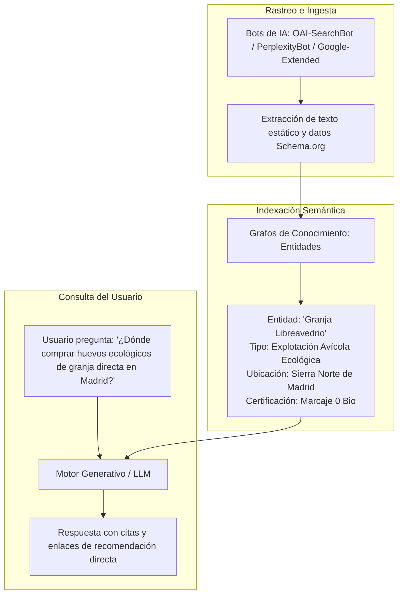
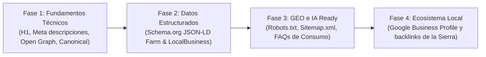

# Informe Estratégico: SEO Tradicional y Optimización para Motores de Inteligencia Artificial (GEO)
**Proyecto:** Granja Libreavedrio (`granjalibreavedrio.es`)  
**Fecha:** Noviembre 2026  
**Objetivo:** Diagnóstico de visibilidad orgánica, adaptación a los nuevos rastreadores de IA (SearchGPT, Perplexity, Gemini AI Overviews) y plan de refuerzo semántico.

---

## 1. Diagnóstico del SEO Actual de la Web

Hemos auditado el código fuente de las 5 páginas activas (`index.html`, `granja.html`, `historia.html`, `principios.html`, `contacto.html`):

| Factor SEO | Estado Actual | Impacto |
| :--- | :--- | :--- |
| **Arquitectura de URLs** | ✅ Multipágina limpia (`.html` estáticos independientes) | Excelente para indexación rápida sin sobrecarga de JS |
| **Velocidad de Carga (Core Web Vitals)** | ✅ Ultrarrápida (< 350ms build, assets minificados) | Factor de ranking prioritario en Google y bots de IA |
| **Contenido y Autenticidad (E-E-A-T)** | ✅ Historia real, datos agronómicos exactos, personas reales | Muy alto valor cualitativo frente a contenido sintético |
| **Etiquetas `<title>`** | ⚠️ Básico (ej. *La Granja \| Libreavedrio*) | Necesitan keywords de intención de búsqueda y localización |
| **Meta Description (`<meta name="description">`)** | ❌ Ausente en todas las páginas | Google e IAs generan fragmentos automáticos imprecisos |
| **Jerarquía de Encabezados (`<h1>`)** | ❌ Inexistente (se salta directo a `<h2>`) | Dificulta saber el tema principal a bots de búsqueda |
| **Open Graph y Twitter Cards (`og:*`)** | ❌ Sin configurar | Al compartir en WhatsApp, Telegram o redes no muestra imagen ni ficha |
| **Datos Estructurados (Schema.org JSON-LD)** | ❌ Ausente | Impide la aparición en el Google Local Pack y fichas enriquecidas |
| **Archivos de Indexación (`robots.txt`, `sitemap.xml`)** | ❌ No creados aún en `/public` | Dificulta el rastreo exhaustivo y control de bots |
| **Atributo Canónico (`rel="canonical"`)** | ❌ Ausente | Riesgo de duplicidad entre `granjalibreavedrio.es` y GitHub Pages |

---

## 2. Cómo Rastrea e Indexa la IA en 2026 (De SEO a GEO: Generative Engine Optimization)

Los buscadores ya no solo comparan palabras clave exactas. Los motores actuales (**Google Gemini AI Overviews**, **SearchGPT / OpenAI**, **Perplexity AI**, **Microsoft Copilot**, **Claude**) operan bajo una nueva lógica:



### ¿Qué buscan las IAs para recomendar una página web?

1. **Entidades Claras frente a "Keyword Stuffing"**:  
   Los LLMs no buscan repetir "huevos ecológicos madrid" 20 veces. Buscan entender **quiénes sois**, **dónde estáis físicamente**, **qué método utilizáis** (ISA Brown, pienso bio, 4 m²/gallina de pinar, ovoscopio en sala de embalaje propia) y **cómo contactaros**.
2. **E-E-A-T (Experiencia, Especialización, Autoridad y Confianza)**:  
   Las IAs discriminan la información genérica de la real. Citan prioritariamente proyectos que demuestran experiencia de campo real (como la tesis doctoral en microbiología de Keila y Miguel, la financiación con banca ética Fiare o el acuerdo circular con la huerta local).
3. **Estructura Respuesta Directa (FAQ & Q&A Semántico)**:  
   Cuando un usuario pregunta a ChatGPT o Perplexity *"¿Cómo sé si los huevos de Libreavedrio son realmente ecológicos?"*, el motor busca fragmentos con estructura pregunta-respuesta que pueda citar textualmente.
4. **Datos Estructurados Schema.org (JSON-LD)**:  
   Es el lenguaje nativo que las IAs y Google leen sin ambigüedades: coordenadas GPS, dirección postal exacta, tipo de negocio (`LocalBusiness` / `Farm`), horarios de reparto y catálogo de productos.

---

## 3. Puntos Fuertes Actuales de Libreavedrio

> [!TIP]
> La web tiene una base excelente que el 90% de las páginas comerciales no tienen: **autenticidad documental**.

- **Transparencia técnica y agronómica inusual:** Muy pocas granjas explican con tanta precisión los metros cuadrados de pinar (7.788 m² de parque, 24.000 m² de finca), el porcentaje de energía fotovoltaica, el control de la Confederación Hidrográfica del Tajo o el uso de gallinaza compostada para huertas locales.
- **Narrativa humana (Storytelling):** La historia de cambio de vida desde la microbiología y el circo hacia la soberanía alimentaria genera un enganche emocional que las IAs valoran como contenido primario y único.
- **Rendimiento técnico limpio:** Al ser páginas HTML estáticas generadas por Vite, los rastreadores de IA consumen el 100% del contenido de forma inmediata sin scripts pesados ni barreras de bloqueo.
- **Localización geoespacial nítida:** La presencia del mapa con coordenadas exactas (`41.055714, -3.607231`), mención a Piñuécar-Gandullas, Salida 83 A1 y Buitrago del Lozoya es ideal para el SEO local en la Sierra Norte.

---

## 4. Hoja de Ruta: Dónde Debemos Reforzar la Web



### Acción 1: Jerarquía de Encabezados `<h1>` y Metaetiquetas
- Incorporar en cada página un único `<h1>` estratégico (oculto visualmente o integrado con elegancia en el diseño) que defina la intención principal:
  - `index.html`: `<h1>Huevos ecológicos de pastoreo en la Sierra Norte de Madrid | Libreavedrio</h1>`
  - `granja.html`: `<h1>Granja avícola ecológica en Piñuécar-Gandullas</h1>`
  - `historia.html`: `<h1>Historia de Libreavedrio: agroecología y soberanía alimentaria</h1>`
  - `contacto.html`: `<h1>Pedidos directos de huevos ecológicos y grupos de consumo</h1>`
- Redactar etiquetas `<meta name="description">` persuasivas de 150-160 caracteres orientadas tanto a personas como a snippets de IA.

### Acción 2: Tarjetas Sociales Open Graph (`og:*`) y Favicons
- Al compartir la web por WhatsApp o redes sociales, debe aparecer automáticamente:
  - Imagen representativa (ej. `images/granja_1.png` o el bosque con el logo).
  - Título limpio y descripción sugerente.

### Acción 3: Integración de Schema.org en formato JSON-LD
Añadir en `index.html` y `granja.html` un bloque que las IAs y Google adoran:
```json
{
  "@context": "https://schema.org",
  "@type": "Farm",
  "name": "Granja Libreavedrio",
  "description": "Granja avícola ecológica de gallinas camperas en pinar de la Sierra Norte de Madrid.",
  "address": {
    "@type": "PostalAddress",
    "addressLocality": "Piñuécar-Gandullas",
    "addressRegion": "Madrid",
    "addressCountry": "ES"
  },
  "geo": {
    "@type": "GeoCoordinates",
    "latitude": 41.0557145,
    "longitude": -3.6072308
  },
  "url": "https://granjalibreavedrio.es",
  "telephone": "+34...",
  "email": "hola@libreavedrio.com"
}
```

### Acción 4: `sitemap.xml` y `robots.txt` orientados a IA
- Crear `public/robots.txt` configurando permisos explícitos para los motores de IA amigables:
  - `GPTBot`, `OAI-SearchBot`, `PerplexityBot`, `ClaudeBot`, `Google-Extended`.
- Crear `public/sitemap.xml` con las 5 URLs limpias bajo el dominio oficial `https://granjalibreavedrio.es/`.

### Acción 5: Sección FAQ estructurada para respuestas directas de IA
Incorporar en la página de La Granja o Contacto un bloque de **Preguntas Frecuentes** (con Schema `FAQPage`):
- *¿Dónde se pueden comprar los huevos de Libreavedrio?* (Mencionando el reparto a domicilio, grupos de consumo y puntos en Madrid).
- *¿Qué significa que los huevos tengan el Marcaje 0?*
- *¿Cómo viven las gallinas en la finca?*
Esto garantiza que cuando alguien pregunte a un asistente de voz o chat de IA, el bot extraiga la respuesta directamente de vuestra web con enlace citado.
