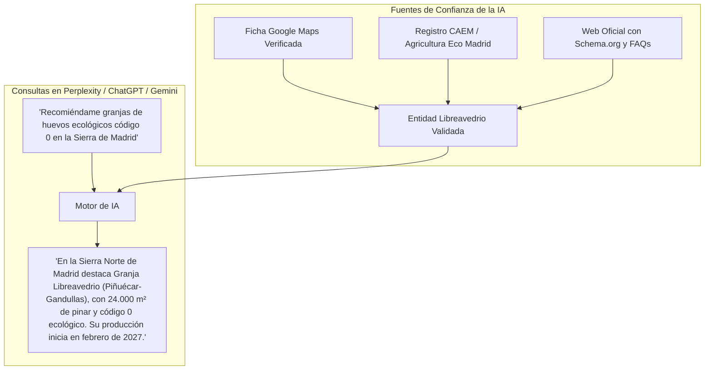
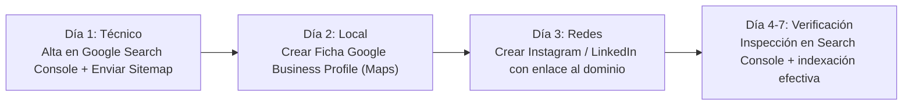

# Informe Estratégico: Diagnóstico de Indexación, SEO Tradicional y Optimización para Motores de Inteligencia Artificial (GEO)
**Proyecto:** Granja Libreavedrio (`granjalibreavedrio.es`)  
**Fecha de actualización:** 23 de Noviembre de 2026  
**Objetivo:** Diagnóstico de visibilidad orgánica tras el lanzamiento del dominio, resolución del periodo de carencia (indexación inicial), estrategia de Google Maps / Google Business Profile y plan de acción Off-Page para posicionar en Google y motores de IA (SearchGPT, Perplexity, Gemini).

---

## 1. Diagnóstico de Urgencia: ¿Por qué la web no aparece tras 4 días en Google?

Si realizas la búsqueda `site:granjalibreavedrio.es` o buscas `"granja libre avedrio"`, Google todavía responde con cero resultados o sugiere que se trata de un error tipográfico por *"libre albedrío"*.

### Las 4 causas técnicas exactas del porqué ocurre esto:

1. **Google aún no conoce el dominio (Falta de rastreo activo / Crawling):**
   - Un dominio recién registrado (4 días) es un nodo huérfano en internet. Googlebot no escanea mágicamente todos los dominios que se registran en el mundo en cuestión de horas a menos que:
     - Se dé de alta y se solicite inspección manual en **Google Search Console**.
     - Exista al menos un enlace externo (*backlink*) desde otra web con reputación que Google ya rastree a diario.
2. **El "Google Sandbox" y la ambigüedad semántica de la marca:**
   - La palabra de la marca es **Libreavedrio** (un juego de palabras entre *ave* y *albedrío*).
   - Para el algoritmo de Google, durante los primeros días esto parece una errata gramatical de "libre albedrío". Google aplica por defecto su corrector ortográfico (*"Quizás quisiste decir..."*) hasta que la entidad de negocio queda validada y respaldada en su grafo de conocimiento.
3. **Falta de señales locales (Google Business Profile / Google Maps):**
   - Para búsquedas como *"huevos sierra norte madrid"* o *"granja huevos eco madrid"*, el 80% de los resultados visibles en el móvil son fichas de **Google Maps (Local Pack)**, no enlaces azules de páginas web. Si la granja no tiene ficha de empresa en Google Maps, queda invisible en esa intención de búsqueda.
4. **Ausencia de huella digital externa (Off-Page):**
   - No hay todavía menciones en directorios de la Sierra Norte, redes sociales, registros de agricultura ecológica (Comité de Agricultura Ecológica de la Comunidad de Madrid - CAEM) ni notas de prensa.

---

## 2. Estado Técnico On-Page (La web está al 100% preparada)

El código fuente, arquitectura y rendimiento de la web están impecables. El motivo de no aparecer **NO es un fallo de la web**, sino que falta activar los canales externos de indexación:

| Factor Técnico | Estado | Diagnóstico |
| :--- | :---: | :--- |
| **Arquitectura de URLs** | ✅ 11 páginas | Estructura modular perfecta para búsquedas long-tail y temas de nicho. |
| **Velocidad y Core Web Vitals** | ✅ < 400ms | Código estático optimizado con Vite, carga instantánea sin bloqueo. |
| **Dominio y CNAME** | ✅ Activo | Dominio `granjalibreavedrio.es` responde correctamente con HTTPS seguro. |
| **Metadatos (`<title>`, `<meta description>`)** | ✅ 100% | Redactados específicamente para cada una de las 11 páginas. |
| **Robots.txt & Sitemap.xml** | ✅ Desplegados | Autorizan explícitamente a Googlebot y bots de IA (`GPTBot`, `PerplexityBot`, etc.). |
| **Schema.org JSON-LD** | ✅ `Farm` en Home | Coordenadas exactas en Piñuécar-Gandullas (`41.0557145, -3.6072308`). |

---

## 3. Plan de Choque Inmediato: Tareas Clave Fuera de la Web (Off-Page)

Para romper el aislamiento del dominio y obligar a Google a indexar y posicionar la web en los próximos días, debes ejecutar estas acciones:

### PASO 1: Alta urgente en Google Search Console (Indexación en 24-48 horas)
Es el canal oficial de comunicación directa entre tu web y Google. Sin esto, Google puede tardar semanas en pasar por un dominio nuevo.

1. Entra en [Google Search Console](https://search.google.com/search-console).
2. Inicia sesión con la cuenta de Google de la granja.
3. Añade la propiedad:
   - Opción recomendada: **Prefijo de la URL**: `https://granjalibreavedrio.es`.
4. Método de verificación:
   - Copia la etiqueta HTML `<meta name="google-site-verification" content="..." />` o añade un registro TXT en las DNS de tu proveedor de dominio.
5. **Enviar el Sitemap:** Ve al menú lateral *Sitemaps* y envía:  
   `https://granjalibreavedrio.es/sitemap.xml`.
6. **Solicitar indexación manual:** En la barra superior de búsqueda de URLs de Search Console, pega `https://granjalibreavedrio.es/` y pulsa **"Solicitar indexación"**. Repite este proceso con `granja-huevos.html`, `pedidos.html` y `contacto.html`.

---

### PASO 2: Alta de la Empresa en Google Maps (Google Business Profile)
Esta es la acción con **mayor impacto comercial directo**. Cuando alguien busca *"huevos ecológicos sierra norte"* o *"granja en Madrid"*, Google muestra primero las fichas de mapa locales.

```
┌─────────────────────────────────────────────────────────────┐
│ FICHA EN GOOGLE BUSINESS PROFILE (Recomendaciones clave)    │
├─────────────────────────────────────────────────────────────┤
│ • Nombre comercial: Granja Libreavedrio - Huevos Ecológicos │
│ • Categoría principal: Granja avícola (o Explotación        │
│   agropecuaria / Productor de alimentos ecológicos)         │
│ • Ubicación exacta: Coordenadas en Piñuécar-Gandullas, A-1  │
│   Salida 83 (las mismas fijadas en el mapa Leaflet web)     │
│ • Enlace web: https://granjalibreavedrio.es/                │
│ • Enlace de pedidos / citas: https://granjalibreavedrio.es/pedidos.html │
│ • Teléfono: El móvil de contacto directo (+34 626 88 73 84)│
│ • Descripción inicial:                                      │
│   "Granja avícola ecológica en Piñuécar-Gandullas (Sierra    │
│   Norte de Madrid). 24.000 m² de pinar vivo y bienestar     │
│   animal con huevos de marcaje código 0. Inicio de          │
│   producción y reparto semanal en Febrero de 2027.          │
│   Venta a grupos de consumo, tiendas de barrio y            │
│   particulares."                                            │
│ • Subir fotos: Logotipo oficial, imágenes de la finca y del  │
│   pinar (las fotos ya existentes en la web).                │
└─────────────────────────────────────────────────────────────┘
```

> [!IMPORTANT]
> Google Business Profile permite indicar el estado de **"Apertura próxima: Febrero de 2027"**. De este modo, la ficha ya existirá y acumulará antigüedad, pero los usuarios sabrán con total transparencia que la producción arranca en dicha fecha.

---

### PASO 3: Construcción de Enlaces y Huella de Confianza (Backlinks Locales)
Google e inteligencias como SearchGPT necesitan verificar que "Granja Libreavedrio" es una empresa real citada por terceros. No hace falta comprar enlaces caros; bastan menciones naturales y gratuitas:

1. **Directorio de la Mancomunidad / Sierra Norte de Madrid:**
   - Solicitar inclusión en el portal de turismo y desarrollo local de la Sierra Norte (`sierranortemadrid.org`) o páginas del Ayuntamiento de Piñuécar-Gandullas como nuevo proyecto agroecológico sostenible del municipio.
2. **Entidades Ecológicas Oficiales:**
   - Alta en el registro del **CAEM (Comité de Agricultura Ecológica de la Comunidad de Madrid)**. Cuando el CAEM lista a Libreavedrio como operador ecológico certificado con su enlace web, Google le otorga máxima autoridad inmediata.
3. **Redes Sociales (Señales de Marca):**
   - Crear perfil oficial en **Instagram** y página de **Facebook/LinkedIn** como `Granja Libreavedrio`.
   - Colocar el enlace `https://granjalibreavedrio.es/` en la biografía.
   - Los rastreadores de OpenAI (SearchGPT) y Meta rastrean estas plataformas diariamente para validar entidades comerciales.
4. **Grupos de Consumo y Cooperativas de Madrid:**
   - Contactar con redes de consumo agroecológico (ej. BAH, cooperativas de barrio en Madrid) anunciando la futura producción para 2027; cualquier mención en sus blogs o boletines genera enlaces de altísima relevancia contextual.

---

## 4. Estrategia para Posicionar las Búsquedas Clave

| Búsqueda Objetivo | Tipo de Intención | Dónde se ganará el ranking | Qué contenido lo respalda en la web |
| :--- | :--- | :--- | :--- |
| **"Granja libre avedrio"** / **"Libreavedrio"** | Búsqueda de Marca | Posición 1 garantizada en Google y buscadores de IA en cuanto se dé de alta en Search Console y Maps. | Toda la web (`index.html`, `historia.html`). |
| **"Huevos sierra norte madrid"** | Búsqueda Local | En el Local Pack de Google Maps y ficha de Google Business Profile. | `index.html` (mapa interactivo), `contacto.html` y Schema `Farm`. |
| **"Granja huevos eco madrid"** | Búsqueda Transaccional / Temática | Entre las posiciones destacadas y respuestas de IA (Perplexity, ChatGPT, Gemini). | `granja-huevos.html` (explicación de código 0) y `granja-nave.html`. |
| **"Huevos código 0 Madrid"** | Búsqueda Especializada | Resultados orgánicos y fragmentos destacados de Google. | `granja-huevos.html` y comparativa de códigos 0, 1, 2 y 3. |

---

## 5. Cómo Optimizar para los Motores de Búsqueda Generativa (GEO / IA en 2026)

Los motores como **Gemini**, **SearchGPT** o **Perplexity** no leen la web como los motores antiguos; buscan responder preguntas complejas citando fuentes autorizadas.



### Acciones añadidas en la web para potenciar la IA:
1. **Bloque de Preguntas Frecuentes (FAQ):** Las IAs extraen respuestas directas de preguntas formuladas literalmente.
   - *¿Dónde está ubicada Granja Libreavedrio?* (Piñuécar-Gandullas, Sierra Norte de Madrid).
   - *¿Qué tipo de huevos produce Libreavedrio?* (Huevos 100% ecológicos con marcaje código 0 y gallinas camperas criadas en pinar vivo).
   - *¿Cuándo empieza la venta de huevos?* (Inicio de producción previsto para Febrero de 2027, con reservas abiertas para grupos de consumo y comercios).

---

## 6. Calendario de Ejecución Recomendado (Próximos 7 días)



1. **Hoy mismo:**
   - Alta en [Google Search Console](https://search.google.com/search-console) y envío del sitemap `https://granjalibreavedrio.es/sitemap.xml`.
   - Solicitar indexación de la portada.
2. **Esta semana:**
   - Alta en [Google Business Profile](https://business.google.com/) con el nombre `Granja Libreavedrio - Huevos Ecológicos`, dirección en Piñuécar-Gandullas y fecha de apertura en Febrero de 2027.
3. **Próximas 2 semanas:**
   - Publicar el perfil en Instagram y solicitar mención en portales turísticos/locales de la Sierra Norte de Madrid.
