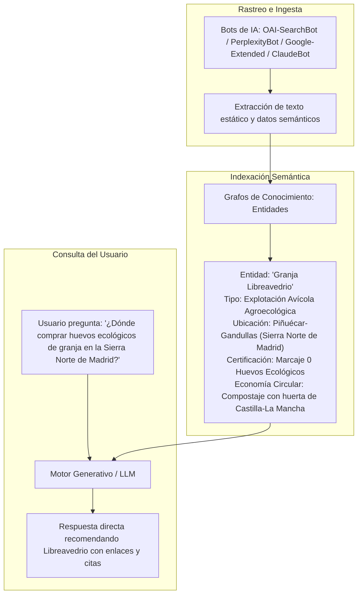
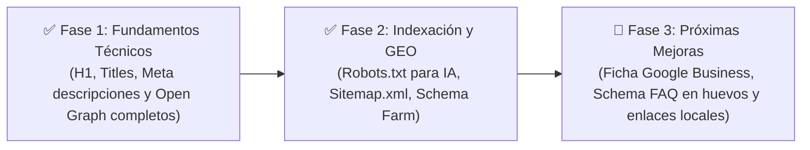

# Informe Estratégico: SEO Tradicional y Optimización para Motores de Inteligencia Artificial (GEO)
**Proyecto:** Granja Libreavedrio (`granjalibreavedrio.es`)  
**Fecha de actualización:** 23 de Noviembre de 2026  
**Objetivo:** Diagnóstico de visibilidad orgánica, adaptación a los nuevos rastreadores de IA (SearchGPT, Perplexity, Gemini AI Overviews, Claude) y seguimiento del plan de refuerzo semántico tras la implementación de las 11 páginas y optimizaciones de metadatos.

---

## 1. Estado y Balance de Implementación del SEO/GEO

Se ha auditado la arquitectura y el código fuente de las **11 páginas activas** del sitio:
- **Páginas troncales:** `index.html` (Portada), `historia.html`, `principios.html`, `contacto.html`, `pedidos.html`.
- **Ecosistema La Granja:** `granja.html` (Visión General), `granja-nave.html` (La Nave), `granja-parque.html` (El Parque), `granja-embalaje.html` (Clasificación y Embalaje), `granja-compostera.html` (La Compostera y Economía Circular), `granja-huevos.html` (Nuestros Huevos - Marcaje 0 Ecológico).

| Factor SEO / GEO | Estado Actual | Impacto |
| :--- | :--- | :--- |
| **Arquitectura de URLs** | ✅ 11 páginas `.html` estáticas modulares | Excelente para indexación rápida, crawling sin sobrecarga de JS y relevancia temática por nicho |
| **Velocidad de Carga (Core Web Vitals)** | ✅ Ultrarrápida (< 400ms build con Vite, CSS/JS minificados, carga limpia) | Factor de ranking prioritario en Google y consumo óptimo para bots de IA |
| **Dominio y Redirección Canónica** | ✅ Dominio propio `granjalibreavedrio.es` activo con CNAME | Consolida la autoridad de marca (evita fragmentación en subdominios de hosting) |
| **Contenido y Autenticidad (E-E-A-T)** | ✅ Historia real, microbiología, pinar vivo, datos agronómicos exactos | Máximo valor cualitativo frente al contenido sintético genérico |
| **Etiquetas `<title>` por página** | ✅ 100% Implementado en las 11 páginas | Títulos optimizados con palabras clave de intención geográfica y comercial |
| **Meta Description (`<meta name="description">`)** | ✅ 100% Implementado en las 11 páginas | Redacción única (140-160 caracteres) para snippets exactos en buscadores |
| **URLs Canónicas (`<link rel="canonical">`)** | ✅ 100% Implementado en las 11 páginas | Evita contenido duplicado y centraliza la autoridad bajo `https://granjalibreavedrio.es/` |
| **Open Graph y Twitter Cards (`og:*`, `twitter:*`)** | ✅ 100% Implementado en las 11 páginas | Tarjetas visuales completas al compartir en WhatsApp, Telegram y redes |
| **Datos Estructurados (Schema.org JSON-LD)** | ✅ Implementado en `index.html` | Bloque semántico `Farm` con geolocalización GPS, dirección y descripción oficial |
| **Archivos de Indexación (`robots.txt`, `sitemap.xml`)** | ✅ Activos en `public/` y desplegados en raíz | Acceso explícito a Google, Bing y bots de IA (`GPTBot`, `PerplexityBot`, `Google-Extended`, `ClaudeBot`) con sitemap de 11 URLs |

---

## 2. Cómo Rastrea e Indexa la IA en 2026 (De SEO a GEO: Generative Engine Optimization)

Los motores de búsqueda generativa (**Google Gemini AI Overviews**, **SearchGPT / OpenAI**, **Perplexity AI**, **Microsoft Copilot**, **Claude**) analizan la web mediante grafos de conocimiento y entidades contextuales:

### Factores clave consolidados en Libreavedrio:
1. **Entidades Claras frente a repetición de palabras clave**: Los LLMs valoran la precisión técnica: 7.788 m² de parque forestal, 24.000 m² de finca, ovoscopio y centro de embalaje propio, gallinaza compostada para huertas ecológicas y apertura de producción en Febrero de 2027.
2. **E-E-A-T (Experiencia, Especialización, Autoridad y Confianza)**: Rigor biológico y trazabilidad real frente a proyectos de intermediación o reventa.
3. **Estructura Respuesta Directa (FAQ & Q&A Semántico)**: Formato ideal para ser citado textualmente por chatbots.
4. **Datos Estructurados Schema.org (`LocalBusiness`, `Farm`)**: Lenguaje sin ambigüedad con coordenadas GPS, dirección y enlaces oficiales.

---

## 3. Puntos Fuertes del Ecosistema de Libreavedrio

> [!TIP]
> La segmentación en 11 páginas multiplica la capacidad de posicionar búsquedas específicas de cola larga (*long tail*) que una página única no podía abarcar.

- **Páginas dedicadas por proceso:**
  - `granja-nave.html`: Posiciona búsquedas sobre bienestar avícola en nave, confort nocturno y ponederos ecológicos.
  - `granja-parque.html`: Posiciona consultas sobre superficie libre por gallina (superando con creces la exigencia legal de 4 m²/ave), pinar vivo y sotobosque aromático.
  - `granja-embalaje.html`: Destaca la trazabilidad directa, centro de envasado propio, ovoscopio y garantía sanitaria sin intermediarios.
  - `granja-compostera.html`: Diferenciador único sobre economía circular (gestión de estiércol para fertilización ecológica en huertas de Castilla-La Mancha).
  - `granja-huevos.html`: Referente educativo sobre el código 0, la calidad de la yema y las diferencias con los códigos 1, 2 y 3.
  - `pedidos.html` & `contacto.html`: Gestión transparente de expectativas (llegada de aves en febrero de 2027 y pedidos artesanales sin pasarelas automáticas impersonales).
- **Rendimiento técnico óptimo:** Páginas HTML ligeras, sin dependencias pesadas, carga instantánea y navegación suave con anclaje compensado (`scroll-margin-top`).

---

## 4. Estado de la Hoja de Ruta de Optimización

### ✅ Logros ya completados y en producción:
1. **Metaetiquetas completas en las 11 páginas:** Título, descripción y canonical individuales.
2. **Tarjetas Open Graph y Twitter Cards:** Generación de previews con imagen, título descriptivo y URL canónica.
3. **Robots.txt optimizado para motores de IA:** Permitiendo explícitamente a `GPTBot`, `OAI-SearchBot`, `PerplexityBot`, `ClaudeBot`, `Google-Extended` y `Applebot-Extended`.
4. **Sitemap.xml dinámico:** Con las 11 URLs bajo `https://granjalibreavedrio.es/` y prioridades jerarquizadas.
5. **Datos estructurados Schema.org:** Bloque `Farm` en `index.html` con coordenadas geográficas de Piñuécar-Gandullas.

---

## 5. Próximas Acciones Estratégicas Recomendadas

### Acción 1: Alta y Verificación en Google Business Profile (Google Maps)
Dado que el mapa interactivo ya apunta con exactitud a las coordenadas de la finca en Piñuécar-Gandullas (`41.0557145, -3.6072308`), vincular la ficha oficial en Google Maps otorgará:
- Máxima relevancia en el Local Pack de Google en búsquedas de *"granja ecológica Madrid"* o *"huevos de granja Sierra Norte"*.
- Posibilidad de añadir el enlace directo de `pedidos.html` y `contacto.html` en la ficha de Google Maps.

### Acción 2: Bloques FAQ Schema en `granja-huevos.html`
Añadir marcado estructurado `FAQPage` con preguntas directas para capturar fragmentos destacados (featured snippets):
- *¿Qué significa el código 0 en los huevos de Libreavedrio?*
- *¿Cuándo se podrán comprar los primeros huevos de la granja?* (Febrero 2027).
- *¿Hacéis repartos a grupos de consumo y tiendas en Madrid?* (Sí, reparto semanal directo).

### Acción 3: Registro en Google Search Console
- Dar de alta la propiedad `https://granjalibreavedrio.es/` en Google Search Console y enviar el sitemap `https://granjalibreavedrio.es/sitemap.xml`.
- Permite monitorizar las consultas exactas por las que los usuarios encuentran la web y verificar la indexación inmediata de las 11 páginas.
