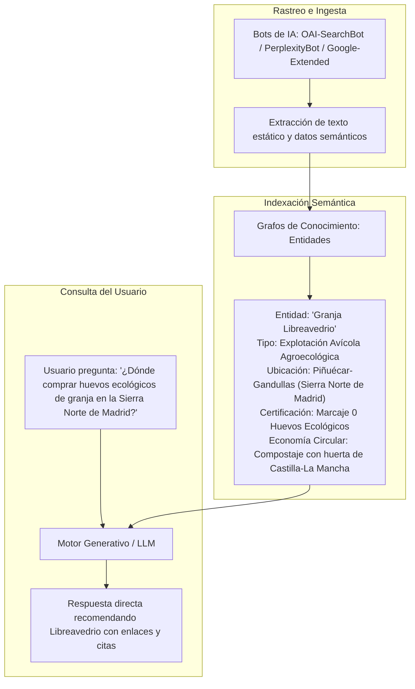
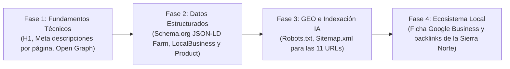

# Informe Estratégico: SEO Tradicional y Optimización para Motores de Inteligencia Artificial (GEO)
**Proyecto:** Granja Libreavedrio (`granjalibreavedrio.es`)  
**Fecha de actualización:** Noviembre 2026  
**Objetivo:** Diagnóstico de visibilidad orgánica, adaptación a los nuevos rastreadores de IA (SearchGPT, Perplexity, Gemini AI Overviews) y plan de refuerzo semántico tras la ampliación de la arquitectura web.

---

## 1. Diagnóstico del SEO Actual de la Web

Se ha auditado la arquitectura y el código fuente de las **11 páginas activas** del sitio:
- **Páginas troncales:** `index.html` (Portada), `historia.html`, `principios.html`, `contacto.html`, `pedidos.html`.
- **Ecosistema La Granja:** `granja.html` (Visión General), `granja-nave.html` (La Nave), `granja-parque.html` (El Parque), `granja-embalaje.html` (Clasificación y Embalaje), `granja-compostera.html` (La Compostera y Economía Circular), `granja-huevos.html` (Nuestros Huevos - Marcaje 0 Ecológico).

| Factor SEO / GEO | Estado Actual | Impacto |
| :--- | :--- | :--- |
| **Arquitectura de URLs** | ✅ 11 páginas `.html` estáticas modulares | Excelente para indexación rápida, crawling sin sobrecarga de JS y relevancia temática por nicho |
| **Velocidad de Carga (Core Web Vitals)** | ✅ Ultrarrápida (< 400ms build con Vite, assets minificados) | Factor de ranking prioritario en Google y consumo óptimo para bots de IA |
| **Dominio y Redirección Canónica** | ✅ Dominio propio `granjalibreavedrio.es` activo con CNAME | Consolida la autoridad de marca (evita fragmentación en subdominios de hosting) |
| **Contenido y Autenticidad (E-E-A-T)** | ✅ Historia real, microbiología, pinar vivo, datos agronómicos exactos | Máximo valor cualitativo frente al contenido sintético genérico |
| **Etiquetas `<title>`** | ⚠️ Parcialmente optimizadas por página | Conviene añadir keywords de intención geográfica y comercial específicas |
| **Meta Description (`<meta name="description">`)** | ⚠️ Pendiente de homogeneizar en las 11 páginas | Crucial para evitar que Google o los bots de IA sinteticen fragmentos imprecisos |
| **Jerarquía de Encabezados (`<h1>` / `<h2>`)** | ⚠️ Encabezados en títulos de sección | Se recomienda unificar un `<h1>` semántico por plantilla para maximizar indexación temática |
| **Open Graph y Twitter Cards (`og:*`)** | ⚠️ Pendiente | Esencial para previsualizaciones enriquecidas en WhatsApp, Telegram y redes |
| **Datos Estructurados (Schema.org JSON-LD)** | ⚠️ Pendiente | Clave para aparecer en Google Local Pack, recetas/productos y respuestas directas de IA |
| **Archivos de Indexación (`robots.txt`, `sitemap.xml`)** | ⚠️ Pendiente de añadir a `/public` | Facilita el mapeo de las 11 páginas y el acceso directo a bots autorizados |

---

## 2. Cómo Rastrea e Indexa la IA en 2026 (De SEO a GEO: Generative Engine Optimization)

Los motores de búsqueda generativa (**Google Gemini AI Overviews**, **SearchGPT / OpenAI**, **Perplexity AI**, **Microsoft Copilot**, **Claude**) analizan la web mediante grafos de conocimiento y entidades contextuales:



### Factores clave para la recomendación por IA:
1. **Entidades Claras frente a repetición de palabras clave**: Los LLMs valoran la precisión técnica: 7.788 m² de parque forestal, 24.000 m² de finca, ovoscopio y centro de embalaje propio, gallinaza compostada para huertas ecológicas y apertura de producción en Febrero de 2027.
2. **E-E-A-T (Experiencia, Especialización, Autoridad y Confianza)**: Rigor biológico y trazabilidad real frente a proyectos de intermediación o reventa.
3. **Estructura Respuesta Directa (FAQ & Q&A Semántico)**: Formato ideal para ser citado textualmente por chatbots.
4. **Datos Estructurados Schema.org (`LocalBusiness`, `Farm`, `Product`)**: Lenguaje sin ambigüedad con coordenadas GPS, horarios y modalidades de entrega.

---

## 3. Puntos Fuertes del Ecosistema de Libreavedrio

> [!TIP]
> La nueva segmentación en 11 páginas multiplica por 10 la capacidad de posicionar búsquedas específicas de cola larga (*long tail*) que una página única no podía abarcar.

- **Páginas dedicadas por proceso:**
  - `granja-nave.html`: Posiciona búsquedas sobre bienestar avícola en nave, confort nocturno y ponederos ecológicos.
  - `granja-parque.html`: Posiciona consultas sobre superficie libre por gallina (superando con creces la exigencia legal de 4 m²/ave), pinar vivo y sotobosque aromático.
  - `granja-embalaje.html`: Destaca la trazabilidad directa, centro de envasado propio, ovoscopio y garantía sanitaria sin intermediarios.
  - `granja-compostera.html`: Diferenciador único sobre economía circular (gestión de estiércol para fertilización ecológica en huertas de Castilla-La Mancha).
  - `granja-huevos.html`: Referente educativo sobre el código 0, la calidad de la yema y las diferencias con los códigos 1, 2 y 3.
  - `pedidos.html` & `contacto.html`: Gestión transparente de expectativas (llegada de aves en febrero de 2027 y pedidos artesanales sin pasarelas automáticas impersonales).
- **Rendimiento técnico óptimo:** Páginas HTML ligeras, sin frameworks SPA pesados, con carga instantánea y navegación suave con anclaje compensado (`scroll-margin-top`).

---

## 4. Hoja de Ruta de Optimización



### Acción 1: Metaetiquetas y jerarquía `<h1>` en las 11 páginas
Asegurar que cada página cuente con un `<h1>` y un `<meta name="description">` específico (140-160 caracteres). Ejemplos:
- `granja-huevos.html`:
  - **Title**: `Huevos Ecológicos Código 0 | Granja Libreavedrio Madrid`
  - **Description**: `Descubre qué significa el marcaje 0 en huevos ecológicos: gallinas en libertad en pinar vivo, alimentación certificada bio y envasado propio en la Sierra Norte.`
- `granja-compostera.html`:
  - **Title**: `Compostaje y Economía Circular | Granja Libreavedrio`
  - **Description**: `Transformamos la gallinaza en abono orgánico para huertas ecológicas de Castilla-La Mancha. Cero residuos y regeneración del suelo.`
- `pedidos.html`:
  - **Title**: `Pedidos de Huevos Ecológicos | Libreavedrio Madrid`
  - **Description**: `Información sobre disponibilidad y pedidos directos de huevos ecológicos en Madrid y Sierra Norte. Apertura de pedidos prevista para febrero de 2027.`

### Acción 2: Tarjetas Sociales Open Graph (`og:*`)
Incluir en todas las cabeceras:
```html
<meta property="og:type" content="website">
<meta property="og:title" content="Libreavedrio | Granja Avícola Ecológica">
<meta property="og:description" content="Huevos ecológicos de gallinas en libertad en pinar de la Sierra Norte de Madrid.">
<meta property="og:image" content="https://granjalibreavedrio.es/images/bosque_1.jpg">
<meta property="og:url" content="https://granjalibreavedrio.es/">
```

### Acción 3: Datos Estructurados Schema.org en Formato JSON-LD
Incorporar en la portada `index.html`:
```json
{
  "@context": "https://schema.org",
  "@type": "Farm",
  "name": "Granja Libreavedrio",
  "description": "Granja avícola ecológica de gallinas camperas en pinar de la Sierra Norte de Madrid.",
  "url": "https://granjalibreavedrio.es",
  "telephone": "+34600000000",
  "address": {
    "@type": "PostalAddress",
    "addressLocality": "Piñuécar-Gandullas",
    "addressRegion": "Madrid",
    "postalCode": "28737",
    "addressCountry": "ES"
  },
  "geo": {
    "@type": "GeoCoordinates",
    "latitude": 41.0557145,
    "longitude": -3.6072308
  },
  "sameAs": [
    "https://github.com/datoscarlesgutierrez-stack/libreavedriov1"
  ]
}
```

### Acción 4: Generación de `robots.txt` y `sitemap.xml`
Crear en `public/`:
- `public/robots.txt`: habilitando el rastreo de motores convencionales y agentes de IA (`GPTBot`, `PerplexityBot`, `Google-Extended`).
- `public/sitemap.xml`: listando las 11 URLs canónicas bajo `https://granjalibreavedrio.es/`.

### Acción 5: Bloques de Preguntas Frecuentes (FAQ Schema)
Implementar preguntas directas en `granja-huevos.html` y `pedidos.html` para captura de snippets enriquecidos en buscadores y LLMs:
- *¿Cuándo estarán disponibles los huevos para pedidos?* (Febrero 2027 tras la llegada de las gallinas a la nave).
- *¿Qué diferencia a los huevos de Libreavedrio respecto a otros huevos camperos?* (Pinar vivo con más de 7.700 m² de parque, alimentación 100% ecológica, envasado propio y código 0).
- *¿Repartís en Madrid capital y grupos de consumo?* (Sí, reparto directo semanal y trato artesanal).
