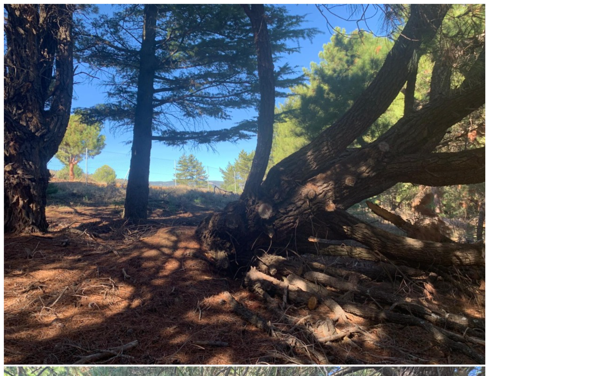

# Libreavedrio - Web Multisección y Modular

Sitio web oficial de **Granja Libreavedrio**, proyecto de avicultura ecológica y sostenible en la Sierra Norte de Madrid.

Diseñado y maquetado con una arquitectura frontend ligera, accesible y responsive basada en **Vite**, **HTML5 semántico**, **CSS nativo con design tokens** y **JavaScript vanilla**.



---

## 📁 Estructura del Proyecto

- `index.html`: Portada con slider hero, manifiesto y accesos principales.
- `historia.html`: Historia y orígenes del proyecto (de la microbiología al campo).
- `principios.html`: Manifiesto y principios ideológicos (bienestar animal, sostenibilidad real, soberanía alimentaria).
- `granja.html`: Visión general de las instalaciones y finca de 24.000 m².
- `granja-nave.html`: Nave de descanso, ventilación natural y ponederos.
- `granja-parque.html`: Parque exterior arbolado de 7.788 m² en pinar vivo.
- `granja-embalaje.html`: Centro propio de clasificación y embalaje con ovoscopio.
- `granja-compostera.html`: Sistema de compostaje e integración con huertas ecológicas de Castilla-La Mancha.
- `granja-huevos.html`: Información sobre el producto, marcaje código 0 y calidad de yema.
- `pedidos.html`: Estado comercial y aviso de apertura (llegada de gallinas en febrero de 2027).
- `contacto.html`: Formulario directo de contacto y pedidos para grupos de consumo.
- `src/`:
  - `config.css`: Variables globales (paleta de colores, tipografías, alturas de cabecera y márgenes de scroll).
  - `style.css`: Hojas de estilos modulares y componentes visuales.
  - `main.js`: Lógica interactiva (menús desplegables, sticky header, scroll y utilidades).
- `public/`:
  - `CNAME`: Archivo de configuración del dominio personalizado (`granjalibreavedrio.es`).
  - `robots.txt`: Directivas de rastreo para buscadores tradicionales y motores de IA.
  - `sitemap.xml`: Mapa del sitio con las 11 URLs canónicas.
  - `images/`: Recursos gráficos, fotografías optimizadas e ilustraciones SVG.

---

## 🔍 Estrategia y Configuración SEO / GEO (Buscadores e IA)

El proyecto cuenta con una implementación completa de **SEO tradicional** y optimización para motores generativos de inteligencia artificial (**GEO - Generative Engine Optimization** para Gemini AI Overviews, SearchGPT, Perplexity y Copilot):

1. **Metaetiquetas por página:** Cada una de las 11 páginas dispone de:
   - `<title>` optimizado con palabras clave temáticas y geográficas.
   - `<meta name="description">` persuasivo y sintético (140-160 caracteres).
   - `<link rel="canonical">` con URL canónica absoluta bajo `https://granjalibreavedrio.es/`.
2. **Open Graph y Twitter Cards:** Etiquetas `og:title`, `og:description`, `og:image`, `og:url` y `twitter:card` en todas las páginas para generar tarjetas visuales atractivas al compartir enlaces en WhatsApp, Telegram, iMessage o redes sociales.
3. **Datos estructurados Schema.org (JSON-LD):** Bloque semántico `Farm` en `index.html` con denominación comercial, geolocalización por coordenadas GPS, dirección física en Piñuécar-Gandullas y enlaces de verificación.
4. **Archivo `public/robots.txt`:** Permite explícitamente el acceso tanto a rastreadores de indexación web general como a agentes de búsqueda de IA (`GPTBot`, `OAI-SearchBot`, `PerplexityBot`, `ClaudeBot`, `Google-Extended`, `Applebot-Extended`).
5. **Archivo `public/sitemap.xml`:** Índice estructurado con las 11 URLs, fechas de última modificación y prioridades de rastreo.

> Para profundizar en el diagnóstico completo, revisa el archivo de auditoría [INFORME_SEO_IA.md](INFORME_SEO_IA.md).

---

## 🔄 ¿Cómo hacer futuros cambios y mantener el SEO actualizado?

Si en el futuro modificas contenidos, agregas una página o cambias rutas, sigue este protocolo:

### 1. Si editas textos o metadatos de páginas existentes:
- Actualiza el `<title>` y `<meta name="description">` en el `<head>` del archivo `.html` correspondiente.
- Si cambias imágenes representativas, actualiza también las etiquetas `og:image` y `twitter:image`.

### 2. Si añades una nueva página HTML:
1. Crea el nuevo archivo HTML con su estructura completa e incluye las etiquetas de SEO (`title`, `description`, `canonical`, Open Graph).
2. Añade la nueva página en `vite.config.js` dentro del objeto `build.rollupOptions.input` para que Vite la compile.
3. Añade la nueva URL dentro de `public/sitemap.xml` con su `<loc>` correspondiente.

### 3. Compilar y publicar los cambios en vivo:
Para que los cambios se reflejen en el dominio público (`granjalibreavedrio.es`), ejecuta siempre:

```bash
npm run deploy
```

> **¿Qué hace este comando?**
> 1. Ejecuta `npm run build`: Vite compila el código, minifica estilos y scripts, procesa las 11 páginas y copia el contenido de `public/` (incluidos `CNAME`, `robots.txt` y `sitemap.xml`) a la carpeta `dist/`.
> 2. Sube el contenido compilado de `dist/` a la rama `gh-pages` de GitHub, actualizando la web en vivo de inmediato.

### 4. Guardar el código fuente en GitHub:
Para respaldar el código fuente en la rama principal (`main`):

```bash
git add .
git commit -m "feat: descripción de tus cambios"
git push origin main
```

---

## 🛠️ Instalación y Desarrollo Local

Requisitos: Node.js (versión 18 o superior).

```bash
# 1. Instalar dependencias
npm install

# 2. Iniciar servidor local de desarrollo con recarga en caliente
npm run dev

# 3. Compilar para producción localmente
npm run build
```

---

## 🌐 Configuración de Dominio y Certificado SSL (HTTPS)

- Dominio principal: `granjalibreavedrio.es` y `www.granjalibreavedrio.es`.
- El archivo `public/CNAME` mantiene vinculado el dominio tras cada despliegue de Vite.
- **HTTPS gratuito:** El certificado SSL es gestionado y renovado automáticamente por GitHub Pages a través de Let's Encrypt. Una vez propagados los registros DNS, la opción **Enforce HTTPS** se habilita desde *Settings > Pages* en el repositorio.

---

## 📄 Licencia

Este proyecto se distribuye bajo la licencia **MIT**, una licencia de código abierto permisiva que permite su uso, modificación, distribución y reutilización libre para proyectos personales o comerciales.

---

## 👨‍💻 Desarrollo Web

- **Carles Gutiérrez**: [Consultoría y Desarrollo Web](https://carlesgutierrez.github.io/consultoria-digital/)
